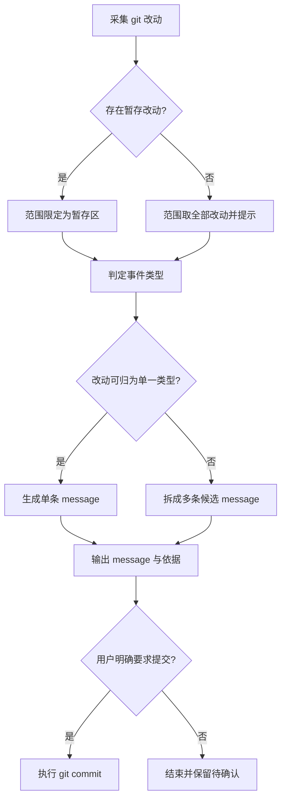

# Git 提交信息

按下图推进，逐节点落实其细则。

## 提交流程



## S1 采集改动

1. S1：先运行 `git status --short` 取得改动清单，再运行 `git diff --stat` 与 `git diff --cached --stat` 判断改动规模与分布。

2. S1：清单为空时直接告知无可提交改动并终止，禁止凭上下文臆造 message。

3. S1：`--stat` 不足以判定改动性质时，对占比最大的文件运行 `git diff <file>` 读取实际内容，禁止仅凭文件名和路径推断。

4. D1：暂存区非空时只依据暂存改动生成；暂存区为空时依据全部改动生成，并在输出中提示存在未暂存文件。

## S4 判定事件类型

5. S4：事件名词只从下表中选取唯一一个最贴切的，禁止自造名词或使用表外名词。

   | 事件名词 | 适用场景 |
   |---|---|
   | feat | 新功能、新模块、新文件引入 |
   | fix | bug 修复、debug 修复、线上问题修复 |
   | docs | 文档整理、注释、README 更新 |
   | refactor | 代码重构、架构调整、目录结构与依赖关系变更，外部行为不变 |
   | chore | 依赖、构建、CI、环境配置变更 |
   | test | 测试用例、测试框架调整 |
   | perf | 性能优化、资源占用优化 |
   | style | UI 样式、代码格式调整 |

6. S4：改动横跨多个类型时，按影响面最大的那一类定标题名词，其余类型在正文要点中说明。

7. S4：按改动意图定类型，不按文件增删定类型。

   > 反例：新增了 `test_parser.py` 就判 `feat`。
   > 正例：新增的是测试文件，判 `test`。

## S5 生成 message

8. S5：标题格式固定为 `<事件名词>: <中文描述>`，名词全小写，冒号后跟一个半角空格。

9. S5：中文描述用动词短语概括改动核心，不超过 20 字，句末不加句号。

   > 示例：
   > ```text
   > feat: 优化                        # 禁止：无信息量
   > fix: 修复了登录接口偶发的 500 错误。  # 禁止：超长且带句号
   > fix: 修复登录接口 500 错误          # 用
   > ```

10. S5：改动集中在单一模块时，用 `<事件名词>(<模块名>): <中文描述>` 标注范围；跨多个模块时省略范围。

    > 示例：`feat(用户): 支持微信登录`。

11. S5：需要补充细节时，在标题下空一行，用 `- ` 开头的要点列表，每条不超过 30 字，最多 5 条。

12. S5：正文只写改了什么和影响面，禁止写实现过程、动机推测、致谢和 AI 生成署名。

13. D2：改动包含多个互不相关的意图时，拆成多条候选 message，每条标注其覆盖的文件，交用户选择，禁止用一条 message 混合概括。

## S7 输出与确认

14. S7：输出 message 全文，并附一句事件类型的判定依据。

15. S7：默认只输出 message，禁止自动执行 `git commit`。

16. S8：用户明确要求提交时，用 `git commit -m` 传入已确认的 message；禁止附加 `--amend`、`--no-verify`，禁止顺带 `git push`。

17. S9：用户未确认前禁止改动工作区、暂存区和分支状态。

## 全局约束

18. 全程只读取 git 信息；需要变更暂存区时提示用户自行执行，禁止代为运行 `git add`、`git reset`、`git checkout`、`git stash`。

19. 事件名词用英文小写，描述与正文用中文；禁止在同一句描述中混排中英文表述，专有名词、标识符、错误码除外。

20. message 只描述本次改动；历史提交、后续计划、待办事项一律不写入。
