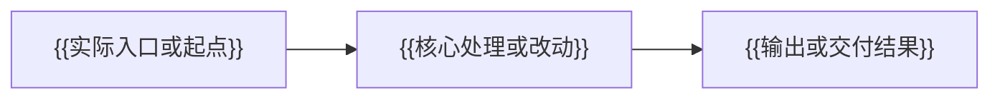

<!-- 复制后替换占位内容和示意图，按需要增减任务，删除注释及不适用的可选章节。 -->

# {{计划名称}}

## 目标与范围

{{写清本次要实现的行为、交付物及用户明确约定的范围。}}

## 现状与关键决策

<!-- 可选：仅保留影响实施的信息；没有相关内容时删除本节。 -->
{{说明已确认的代码事实、复用位置和本次采用的设计；文件链接相对当前文档解析。}}
{{仍有关键假设或待用户决定的事项时单独写明，不能描述为已确认事实。}}

## 实施任务

<!-- 按依赖顺序排列；与 YAML todos 使用相同 ID。按任务需要重复以下条目。 -->
- [ ] `{{稳定任务标识}}` {{实施任务标题}}
  - 改动位置：{{文件路径、函数或模块；新增位置注明“拟新增”。}}
  - 实施动作：{{具体改动；必要时补充输入输出、数据结构和关键分支。}}
  - 依赖：{{仅填写实际存在的前置任务或条件，否则删除此行。}}
  - 完成结果：{{这一步交付后应具备的可观察结果。}}

## 流程图

<!-- 改成实际业务流程、调用关系或关键判断；文档类需求可画实际交付步骤。 -->

## 验证方式

{{根据用户要求填写必要的简单校验、无需校验，或明确要求的测试范围。未要求测试时不生成测试任务。}}

<!-- 实施后如需汇总落地结果或继续条件，插在确认点之前；初次生成时删除此注释，不预留空章节。 -->

## 计划落地确认点

- 实施范围：{{本次将交付的内容。}}
- 关键决策：{{需要用户确认的选择或假设；没有时删除此行。}}
- 完成判据：{{满足哪些实际结果即视为本次范围落实；无需默认绑定测试。}}
- [ ] 用户确认按本计划实施
