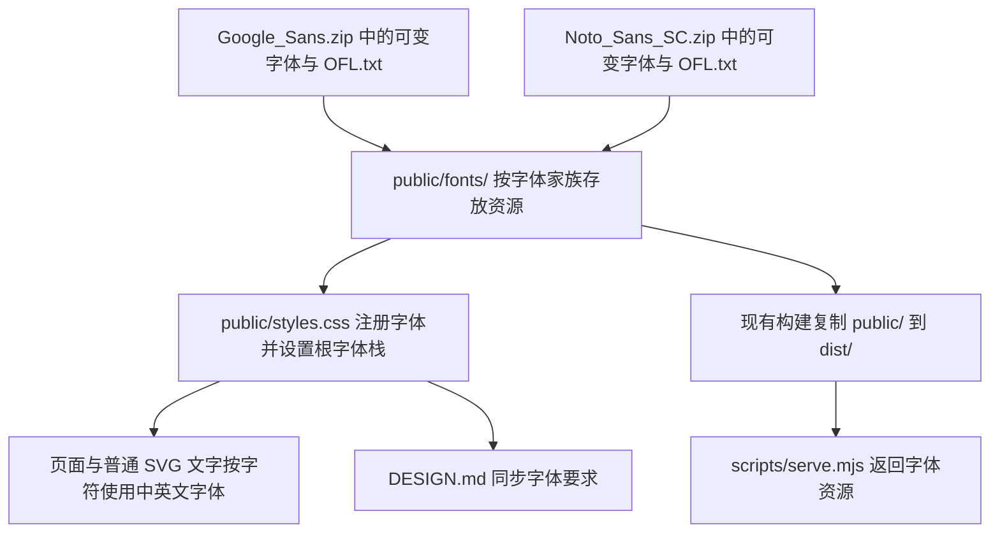

# 中英文字体本地接入

## 目标与范围

根据 [01_prd.md](../prd/01_prd.md)，为现有页面的英文使用 Google Sans、中文使用 Noto Sans SC，将实际使用的字体文件解压至前端静态资源目录，并同步覆盖 [DESIGN.md](../../DESIGN.md) 中的字体要求。

本次只调整字体家族及其加载方式。现有字号、字重数值、行高、字距、颜色、间距、布局、主题与交互保持当前配置；不引入组件库，不迁移样式框架。

## 现状与关键决策

### 实施前确认的现状

- [public/styles.css](../../public/styles.css) 的 `:root` 使用 Inter 与系统字体栈，没有本地 `@font-face`。`button,input` 已通过 `font: inherit` 继承字体；部分章节编号、矩阵和数值展示明确使用等宽字体。
- [index.html](../../index.html) 加载 `./styles.css`，初始加载提示单独写了 `font-family:sans-serif`。[src/app.tsx](../../src/app.tsx) 的 `MathBlock` 通过 MathJax 生成 SVG 公式，普通 SVG 图表文字没有单独指定字体家族。
- [scripts/build.mjs](../../scripts/build.mjs) 将 `public/` 递归复制到 `dist/`；[vite.config.ts](../../vite.config.ts) 使用相对基础路径。现有资源目录即可承载字体，不需要调整构建脚本。
- [scripts/serve.mjs](../../scripts/serve.mjs) 的静态预览服务尚未声明 `.ttf` 的响应类型。
- [DESIGN.md](../../DESIGN.md) 当前要求标题使用 Titillium Web，正文与界面使用 Inter；这些要求分布在 YAML、概述、Typography、Do's and Don'ts 等位置。本次以 PRD 指定的中英文字体覆盖这些要求。

### 字体资源方案

已直接读取两个压缩包的目录与字体 `fvar` 元数据，选用以下正体可变字体：

| 来源压缩包 | 包内字体文件 | 实际字重范围 | 解压后大小 |
| --- | --- | --- | --- |
| [Google_Sans.zip](../assets/Google_Sans.zip) | `GoogleSans-VariableFont_GRAD,opsz,wght.ttf` | 400–700 | 4.74 MiB |
| [Noto_Sans_SC.zip](../assets/Noto_Sans_SC.zip) | `NotoSansSC-VariableFont_wght.ttf` | 100–900 | 16.89 MiB |

两份字体合计约 21.64 MiB。采用原始 TTF 直接接入，不安装字体处理工具，不进行 WOFF2 转换或字符子集裁剪。首次访问包含中文和英文的页面时，需要下载这两份字体；使用 `font-display: swap`，加载期间允许系统字体先显示文字。该方案优先减少本次改动与依赖，字体体积是本次确认项。

只提取使用中的两份可变字体及各自 `OFL.txt`，不把静态字重全集和斜体全集复制到前端。保留原始压缩包。

拟新增目录与文件：

```text
public/fonts/
├── google-sans/
│   ├── GoogleSans-Variable.ttf
│   └── OFL.txt
└── noto-sans-sc/
    ├── NotoSansSC-Variable.ttf
    └── OFL.txt
```

字体家族统一使用 `"Google Sans", "Noto Sans SC", system-ui, -apple-system, BlinkMacSystemFont, "PingFang SC", "Microsoft YaHei", sans-serif`。Google Sans 优先承载英文与数字，中文使用 Noto Sans SC；已检查样例汉字和中文标点在 Google Sans 中缺失、在 Noto Sans SC 中存在。

按字体真实范围声明 `font-weight`。当前样式中存在 720、750、800 等字重值，本次不改这些数值；Google Sans 不具备独立的 700 以上可变字重，英文效果由浏览器进行字重匹配。Google Sans 的 `opsz`、`GRAD` 不另行定制。

明确保留已有 `ui-monospace`、`Consolas` 等等宽规则以及 MathJax SVG 公式字体。它们承担数值对齐和数学排版，不套用全站字体覆盖。

## 实施任务

- [x] `local-font-assets` 提取并归档本地字体资源。
  - 改动位置：上文目录中的四个文件，均为拟新增；来源为 [Google_Sans.zip](../assets/Google_Sans.zip) 与 [Noto_Sans_SC.zip](../assets/Noto_Sans_SC.zip)。
  - 实施动作：按明确的压缩包条目提取两份正体可变 TTF，分别重命名为 `GoogleSans-Variable.ttf`、`NotoSansSC-Variable.ttf`；各自原样保留 `OFL.txt`。不解压其他字体到资源目录。
  - 完成结果：`public/fonts/` 包含可直接分发的两份字体与对应许可证，资源来源明确。
  - 落地结果：四个资源文件已提取，文件内容与压缩包对应条目逐字节一致；两份 TTF 共 22,686,176 字节。

- [x] `integrate-font-loading` 将字体接入全站及现有预览服务。
  - 改动位置：[public/styles.css](../../public/styles.css)、[index.html](../../index.html)、[scripts/serve.mjs](../../scripts/serve.mjs)。
  - 实施动作：在样式表顶部添加两条 `@font-face`，使用 `format("truetype")`、`font-style: normal`、`font-display: swap`，分别声明 `font-weight: 400 700` 与 `font-weight: 100 900`；路径使用相对于样式表的 `./fonts/google-sans/GoogleSans-Variable.ttf` 和 `./fonts/noto-sans-sc/NotoSansSC-Variable.ttf`。
  - 实施动作：在 `:root` 新增 `--font-sans` 保存统一字体栈，并将根字体改为 `font-family: var(--font-sans)`。沿用现有表单控件与普通 SVG 文字的继承关系，不添加全元素强制字体规则。
  - 实施动作：移除初始加载提示中的单独 `font-family:sans-serif`，使其继承全站字体；给静态预览服务的响应类型表补充 `.ttf: font/ttf`。
  - 依赖：`local-font-assets`。
  - 完成结果：标题、正文、导航、按钮、输入框、初始加载提示和普通 SVG 图表文字使用统一的中英文字体栈，原有等宽内容与 MathJax 公式保持专用字体。构建后的 CSS 相对路径仍能找到字体资源。
  - 落地结果：已添加两个 `@font-face` 和 `--font-sans`，移除加载提示的字体覆盖，并补充 `.ttf` 的 `font/ttf` 响应类型；构建及 HTTP 校验结果见落地结果章节。

- [x] `align-design-font-rules` 使设计文档与实际字体方案一致。
  - 改动位置：[DESIGN.md](../../DESIGN.md) 的 YAML `description`、`typography.*.fontFamily`，以及正文中涉及字体的概述、Typography、Do's and Don'ts 条目。
  - 实施动作：将标题与正文的字体要求统一改为英文 Google Sans、中文 Noto Sans SC，注明字体目录、本地加载方式、实际字重范围与专用字体例外；替换原有 Titillium Web 与 Inter 的角色限制及字体外观描述。新增或修改的描述性文字使用简体中文，未涉及的段落保留。
  - 实施动作：保留其他设计参数及排版层级中的字号、字重等数值，注明本次只落地字体家族，页面继续沿用现有 CSS 排版值；文档中超出 Google Sans 400–700 范围的字重不视为该字体已提供的字重。
  - 依赖：`integrate-font-loading`。
  - 完成结果：设计文档对字体的要求与代码一致，其他设计规范没有随本次字体接入被重做。
  - 落地结果：已统一 11 个 `fontFamily` 声明，并更新概述、Typography 与使用约束，补充资源路径、体积、字重范围和专用字体例外。

## 流程图



## 验证方式

仅进行与本次改动直接相关的轻量校验，不新增测试用例，不运行测试套件。

- 检查解压结果、两个 `OFL.txt`、CSS 资源路径和 `@font-face` 字重范围；执行差异格式检查，确认改动限于本计划列出的字体资源与文件。
- 执行一次 `npm run build`，确认 `dist/fonts/` 包含两份字体及许可证；构建沿用现有流程，不额外运行独立类型检查或其他构建命令。
- 使用现有预览服务请求两个字体 URL，确认返回成功且响应类型为 `font/ttf`。浏览器可用时，检查首页、课程页和移动宽度下的中英文实际渲染字体、标题换行、按钮文字、普通 SVG 文字、等宽数值和数学公式。浏览器不可用时如实记录人工视觉检查尚未完成。

## 落地结果

- 三项实施任务均已完成：两份字体和许可证已归档至 `public/fonts/`，全站字体与预览服务已接入，`DESIGN.md` 的 11 个字体声明和相关使用规则已同步。
- `npm run build` 执行成功；构建后的字体、许可证、样式和 HTML 与源文件内容一致。两个字体 URL 均返回 HTTP 200、`Content-Type: font/ttf`，响应内容与源字体一致；两个许可证 URL 也返回 HTTP 200。校验结束后已关闭临时预览服务。
- 差异格式、字体来源与资源路径检查通过；除新增字体声明和根字体栈外，其余 CSS 内容与实施前一致。未新增测试用例、未运行测试套件。当前环境没有可用浏览器，首页、课程页及移动宽度下的实际渲染字体、换行和视觉效果尚未人工检查。

## 计划落地确认点

- 实施范围：新增两份本地可变字体和许可证，修改 `public/styles.css`、`index.html`、`scripts/serve.mjs` 与 `DESIGN.md`，不扩展到组件或页面改版。
- 关键决策：字体放置在 `public/fonts/`；直接分发合计约 21.64 MiB 的原始 TTF；使用 `font-display: swap`；保留现有排版参数、等宽内容与 MathJax 公式字体。
- 完成判据：字体资源可随静态构建交付并通过 HTTP 加载；普通页面文字按中英文使用指定字体；设计文档不再要求旧字体；完成上述轻量校验并如实记录视觉检查情况。
- [x] 用户确认按本计划实施

用户已授权：`落地 hiduck/plan/2026-11-12-中英文字体接入.md`。
