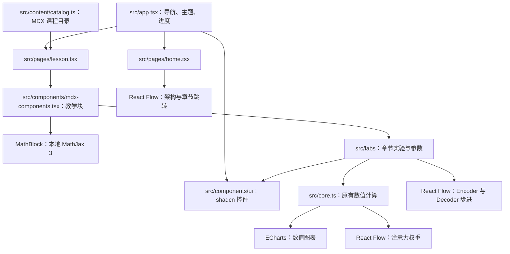

# 组件库接入与交互体验完善

## 目标与范围

落实 [02_prd.md](../prd/02_prd.md) 提出的界面与教学可视化改进：通用控件采用 shadcn，数值图表采用 ECharts，模型关系采用 React Flow，正文采用 MDX，公式沿用 MathJax，在现有代码上完成组件规范和交互体验的补齐。

保留现有 14 章内容、Hash 路由、学习进度、主题切换、本地字体和静态部署方式。数值计算继续由 [src/core.ts](../../src/core.ts) 提供；本次不新增后端、真实模型推理、流程编辑器或另一套数学渲染工具。

## 当前实现与调研结论

当前仓库已完成大部分技术接入，实施时不能按早期的单文件 React 与手写 CSS 结构重新迁移。

| 工具 | 当前代码事实 | 本次采用方式 |
| --- | --- | --- |
| shadcn | `src/components/ui/` 已有 Radix、cva 本地封装 | 采用官方 Radix 组件源码，适配当前样式 |
| ECharts | `charts.tsx` 已有分布图、位置编码曲线 | 沿用封装，按需注册并完善数值说明 |
| React Flow | 已有架构、注意力、层级三类流程图 | 沿用节点和连线，完善语义与操作 |
| MDX | Vite 已配置插件，课程已拆成 14 个 `.mdx` | 保留编译与目录，统一教学块排版 |
| MathJax | 本地 MathJax 3 已通过 `MathBlock` 渲染 SVG | 保留本地运行时和公式组件 |

关键依据与实际差距如下。

1. [package.json](../../package.json)、[vite.config.ts](../../vite.config.ts) 已配置上述依赖及 Tailwind v4。现有 UI 封装不能仅因采用 Radix 就认定与 shadcn 官方源码一致；根目录也没有 `components.json`。官方说明该文件仅在使用 CLI 时必需，因此缺少配置不代表现有组件不可用。本次新增配置是为了明确后续组件维护方式。[shadcn Vite 接入](https://ui.shadcn.com/docs/installation/vite)、[components.json 说明](https://ui.shadcn.com/docs/components-json)
2. [charts.tsx](../../src/components/charts.tsx) 当前全量导入 ECharts；`WaveChart` 的无障碍标签描述正弦与余弦，但实际只有两条正弦曲线。[layer-flow.tsx](../../src/components/layer-flow.tsx) 的跨层连线从 Decoder 指向 Encoder K/V，需要明确区分查询关系与输入数据流。三类流程图均关闭了平移和缩放，窄屏体验需在实施时实际检查。[ECharts 按需导入](https://echarts.apache.org/handbook/en/basics/import/)、[React Flow 可访问性](https://reactflow.dev/learn/advanced-use/accessibility)
3. [catalog.ts](../../src/content/catalog.ts)、[mdx-components.tsx](../../src/components/mdx-components.tsx) 已负责课程加载和教学块映射；[math-block.tsx](../../src/components/math-block.tsx) 已处理启动等待、SVG 排版与容器缩放。这部分继续复用，不再新增 MDX 或 MathJax 接入层。[MDX 的 Vite 插件](https://mdxjs.com/packages/rollup/)、[MathJax 动态内容说明](https://docs.mathjax.org/en/latest/web/typeset.html)

以上为源码检查结果，尚未据此断言页面在浏览器中的视觉效果或运行性能存在具体故障。

## 设计与接入决策

以当前浅色、深色两套配色和薄荷绿强调色组织教学页面。Google Sans、Noto Sans SC 和等宽数字的分工保持不变；调整重点是阅读宽度、信息层级、控件状态和图示说明，不套用新的整站模板。

shadcn 采用 Radix 版本的官方组件源码，保留 `src/components/ui/` 和 `@/` 导入路径。拟新增的 `components.json` 使用 `rsc: false`、`tsx: true`，CSS 指向 `src/app/globals.css`，Tailwind v4 不新增配置文件。采用 `cssVariables: false` 生成工具类，再将源码样式适配现有颜色、圆角与阴影 token，避免新增的 `muted` 背景语义与当前 `muted` 文字颜色混淆。组件源码保存在仓库，所需依赖以实际采用的官方源码为准，不整体升级现有依赖。

三类可视化各自承担明确职责：ECharts 表达数值，React Flow 表达模型结构与数据流，MathJax 表达公式。当前 `Matrix` 和各章实验保留为教学业务组件，不要求每个 HTML 元素都替换成组件库控件。

## 实施任务

- [ ] `shadcn-ui-baseline` 规范通用组件与交互语义。
  - 改动位置：`components.json`（拟新增）、[src/components/ui/](../../src/components/ui/)、[globals.css](../../src/app/globals.css)、[app.tsx](../../src/app.tsx)、[lab-frame.tsx](../../src/labs/lab-frame.tsx)、[attention-lab.tsx](../../src/labs/attention-lab.tsx)；必要时同步 [package.json](../../package.json) 与锁文件。
  - 实施动作：对照官方 Radix 版本整理 Button、Card、Badge、Input、Tabs、Slider、Switch、Progress、ScrollArea、Separator、Sheet，逐项保留已有可复用部分。为按钮、输入和切换控件统一悬停、选中、禁用和键盘焦点样式。
  - 实施动作：补齐 `TabsContent`，让 Attention 的四个计算阶段与各自标签页建立对应关系；`ChoiceRow` 为当前选项提供 `aria-pressed`。移动导航使用完整 Sheet 组合，关联打开按钮、标题与内容，并处理关闭后的焦点返回。
  - 完成结果：实际使用的控件具有明确的 shadcn 来源与本地定制约定，标签页、滑块和移动导航保留原功能并能通过键盘操作。

- [ ] `lesson-reading-layout` 统一课程阅读与操作层级。
  - 改动位置：[home.tsx](../../src/pages/home.tsx)、[lesson.tsx](../../src/pages/lesson.tsx)、[sidebar.tsx](../../src/components/sidebar.tsx)、[mdx-components.tsx](../../src/components/mdx-components.tsx)、[lab-frame.tsx](../../src/labs/lab-frame.tsx)、[matrix.tsx](../../src/components/matrix.tsx)、[math-block.tsx](../../src/components/math-block.tsx)。
  - 依赖：`shadcn-ui-baseline`。
  - 实施动作：限制大屏正文的阅读宽度，统一问题、公式、输入输出、推导步骤、实验和结论的间距与标题层级。侧边导航提供清晰的当前章节状态；普通说明、关键数值与主要操作使用不同的视觉权重。
  - 实施动作：在现有 MDX 教学块上应用统一排版，保留正文与实验的分离。数学公式继续复用 MathJax 3 的现有渲染流程，调整容器布局，保证长公式和矩阵在窄屏内可查看，避免撑宽整个页面。
  - 完成结果：首页与课程页使用同一套控件和排版规则，学习内容、实验入口和当前章节可辨识，原有公式与章节跳转可继续使用。

- [ ] `echarts-teaching-views` 完善数值图表及计算说明。
  - 改动位置：[charts.tsx](../../src/components/charts.tsx)、[chart-palette.ts](../../src/components/chart-palette.ts)、[position-lab.tsx](../../src/labs/position-lab.tsx)；其他图表调用按需同步。
  - 依赖：`shadcn-ui-baseline`。
  - 实施动作：从 `echarts/core` 按需注册实际使用的柱状图、折线图、坐标系、图例、提示框、标线、标点及 Canvas 渲染器，沿用现有 resize 与 dispose 生命周期。
  - 实施动作：统一数值与百分比格式、图例、提示框及主题颜色。位置编码图展示选定两种频率各自的 sin/cos 曲线，当前位置标记、图例、文字与 `positionalEncoding` 的维度约定一致。
  - 实施动作：Attention、Mask、训练和生成继续使用原计算结果绘图；在现有说明处保留可读数值，不把信息仅放在鼠标悬停提示中。对长标签预留空间，避免与柱尾数值重叠。
  - 完成结果：调整现有参数时图表与文字同步，位置编码的曲线名称、函数和数值相符，深浅色下标签与数据均可辨识。

- [ ] `model-flow-interactions` 完善模型结构与数据流展示。
  - 改动位置：[architecture-flow.tsx](../../src/components/architecture-flow.tsx)、[attention-flow.tsx](../../src/components/attention-flow.tsx)、[layer-flow.tsx](../../src/components/layer-flow.tsx)、[flow-edge.tsx](../../src/components/flow-edge.tsx)、[layer-lab.tsx](../../src/labs/layer-lab.tsx)。
  - 依赖：`shadcn-ui-baseline`、`lesson-reading-layout`。
  - 实施动作：保留架构图点击跳转、Attention 权重高亮、Encoder/Decoder 步进；为数据流补充来源、目标和关键张量说明，箭头与当前说明面板一致。跨层连线采用 Encoder K/V 输入 Decoder Cross-Attention 的方向，在节点说明中解释 Decoder 提供 Q。
  - 实施动作：为图示添加明确的缩放与适配视图操作，保持正常页面滚动，继续禁止拖动节点和修改连线。窄屏下让并列结构改为可阅读的布局，并在容器宽度变化后重新适配视图，避免仅将整张图缩到文字不可辨识。
  - 实施动作：保留现有减弱动态效果的处理，为可点击节点提供中文名称、焦点反馈和键盘激活方式。复用现有节点与边定义，静态节点数组保持稳定。
  - 完成结果：用户能辨认每条主要数据流并查看当前步骤；手机宽度下能查看节点说明并操作流程图，既有课程跳转和数值联动继续有效。

- [ ] `document-integration-rules` 同步实际组件规范与维护说明。
  - 改动位置：[DESIGN.md](../../DESIGN.md)、[README.md](../../README.md)。
  - 依赖：前四项。
  - 实施动作：在设计文档中说明实际采用的控件样式、课程阅读层级、图表颜色与流程图约定；在 README 中更新组件来源、MDX 教学块写法和新增课程的接入位置。
  - 实施动作：说明哪些 shadcn 组件经过本地样式定制，记录实际使用的依赖及本地 MathJax 3，不把最新官方文档中的 MathJax 4 行为当作当前运行时事实。
  - 完成结果：文档与代码一致，维护者能按既有目录继续编写课程并复用组件。

## 调用关系

## 轻量校验方式

实施阶段运行一次 `npm run build`，利用现有脚本完成 TypeScript 检查与生产构建，确认 MDX、按需 ECharts 和本地资源能够打包。运行 `git diff --check` 检查格式。本次只生成计划，不运行构建，也不新增测试用例或运行测试套件。

若实施环境有可用浏览器，检查首页以及 Position、Attention、Encoder、Decoder 课程，覆盖桌面与约 390px 的窄屏、两种主题、标签页和滑块操作、流程图查看、章节跳转、进度保存及移动导航焦点。其余章节检查入口与正文是否可加载。没有浏览器时如实记录未完成的视觉检查，不将构建通过描述为体验已验证。

## 计划落地确认点

- 实施范围：规范实际使用的 shadcn 组件，完善已有 ECharts、React Flow、MDX 与 MathJax 展示，更新对应文档。
- 关键决策：在当前实现上补齐，不重新迁移构建系统；shadcn 使用 Radix 组件并适配现有 token；保留本地 MathJax 3、字体、课程和计算逻辑。
- 完成判据：五项任务交付，现有课程与交互可继续使用，图示语义与计算一致，生产构建通过；实际视觉检查情况在本计划中如实记录。
- [ ] 用户确认按本计划实施
